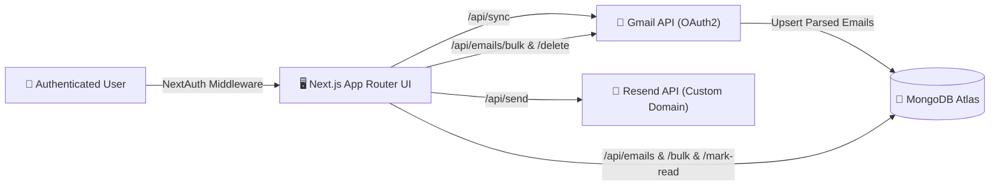

<div align="center">

# 📬 Mail Dashboard — Personal Email Workspace

**A full-stack, dark-themed Gmail & Custom Domain Email Client built with Next.js 16, MongoDB, Google OAuth2, and Resend.**

[](https://nextjs.org/)
[](https://react.dev/)
[](https://tailwindcss.com/)
[](https://www.mongodb.com/)
[](https://next-auth.js.org/)
[](https://resend.com/)
[](./LICENSE)

[Features](#-key-features) • [Architecture](#-system-architecture) • [Screenshots](#-screenshots) • [Tech Stack](#-tech-stack) • [Getting Started](#-getting-started) • [License](#-license)

</div>

---

## 📖 Overview

**Mail Dashboard** is a custom, full-stack email management workspace designed to unify **Gmail inbox synchronization** and **custom-domain outbound emails** into a fast, distraction-free dark UI.

Instead of switching between multiple webmail clients, it syncs Gmail messages into **MongoDB Atlas** for instant querying, sanitizes HTML email bodies safely with **DOMPurify**, sends custom-domain emails via **Resend** with rich-text formatting and attachments, and locks down all routes behind **NextAuth Google OAuth2** with strict email-based access control.

---

## ✨ Key Features

- 🔄 **Gmail API Sync & MongoDB Caching**
  - Pulls messages from Gmail via `googleapis`, decodes Base64URL MIME payloads, and upserts structured records into MongoDB Atlas (`/api/sync`, `/api/emails`).
  - Supports instant pagination, live client-side search, and fallback to cached emails if Gmail tokens expire.
- ✉️ **Custom Domain Sending & Rich-Text Composer**
  - Send emails from custom aliases (`<prefix>@domain`) powered by **Resend** (`/api/send`).
  - Includes a rich-text editor (Bold, Italic, Strikethrough), multi-file Base64 attachments, Cc/Bcc support, auto-BCC archiving, and `localStorage`-backed sender/contact autocomplete.
- 🔐 **OAuth2 Authentication & Whitelisted Access Control**
  - Protected end-to-end by **NextAuth.js** (`GoogleProvider`) and [`src/middleware.js`](src/middleware.js).
  - Strictly enforces an `ALLOWED_EMAILS` whitelist on both sign-in and active sessions.
- 🛡️ **XSS-Safe HTML Email Rendering**
  - Sanitizes incoming HTML email bodies using `isomorphic-dompurify` before rendering in the reading pane.
- ⚡ **Bulk Operations & Folder Navigation**
  - Switch across **Inbox**, **Sent**, **Starred**, **Drafts**, and **Trash** folders.
  - Perform single or bulk **Archive**, **Trash**, and **Mark as Read** actions synced across both Gmail and MongoDB.
- 🔑 **Automated OAuth2 Refresh Token CLI**
  - Includes [`scripts/get-refresh-token.js`](scripts/get-refresh-token.js) to spin up a local OAuth callback server, acquire a fresh Gmail `refresh_token`, and write it directly to `.env.local`.

---

## 🏗️ System Architecture



---

## 📸 Screenshots

> **Note:** Upload your screenshots to `docs/screenshots/` with the filenames below to display them automatically.

| Inbox & Reading Pane | Rich-Text Compose Modal |
| :---: | :---: |
|  |  |

---

## 🛠️ Tech Stack

| Layer | Technology |
| :--- | :--- |
| **Framework** | Next.js 16 (App Router), React 19 |
| **Styling & Icons** | Tailwind CSS v4, Lucide React |
| **Authentication** | NextAuth.js v4 (Google OAuth2 + Middleware) |
| **Database** | MongoDB Atlas, Mongoose & MongoDB Driver |
| **Email APIs** | Google Gmail API (`googleapis`, `mailparser`), Resend |
| **Security** | `isomorphic-dompurify` (HTML Sanitization), Email Whitelisting |

---

## 📁 Project Structure

```text
mail-dashboard/
├── scripts/
│   └── get-refresh-token.js        # CLI helper to generate & save Gmail OAuth2 refresh token
├── src/
│   ├── app/
│   │   ├── api/
│   │   │   ├── auth/[...nextauth]/ # NextAuth Google OAuth2 + email whitelist callbacks
│   │   │   ├── emails/             # Fetch, bulk archive/trash, delete, mark-read endpoints
│   │   │   ├── send/               # Resend outbound email endpoint with attachments
│   │   │   └── sync/               # Gmail-to-MongoDB sync engine
│   │   ├── globals.css
│   │   ├── layout.js
│   │   └── page.js                 # Main 3-pane email workspace
│   ├── components/
│   │   ├── AuthProvider.js
│   │   ├── ComposeModal.js         # Rich-text composer, attachments, alias & contact suggestions
│   │   ├── EmailList.js            # Searchable, paginated list with bulk selection & auth banner
│   │   ├── ReadingPane.js          # Sanitized HTML email viewer & reply/archive/trash actions
│   │   └── Sidebar.js              # Folder navigation & sync trigger
│   ├── lib/
│   │   ├── db.js                   # Cached Mongoose connection helper
│   │   └── gmailSync.js            # Gmail API token refresh & MIME parser utility
│   ├── models/
│   │   └── Email.js                # Mongoose Email schema with indexed labels & threadId
│   └── middleware.js               # Route protection & session email verification
├── .env.example                    # Environment variable template
├── LICENSE                         # Proprietary — All Rights Reserved
└── package.json
```

---

## 🚀 Getting Started

### 1. Prerequisites
- **Node.js** 18+ and **npm**
- A **MongoDB Atlas** cluster
- A **Google Cloud** project with the **Gmail API** enabled and OAuth2 credentials
- A **Resend** account with a verified sending domain

### 2. Installation

```bash
git clone https://github.com/TheHemantPandey/mail-dashboard.git
cd mail-dashboard
npm install
```

### 3. Configure Environment Variables

Copy `.env.example` to `.env.local` and fill in your credentials:

```bash
cp .env.example .env.local
```

| Variable | Description |
| :--- | :--- |
| `GOOGLE_CLIENT_ID` | Google OAuth2 Client ID |
| `GOOGLE_CLIENT_SECRET` | Google OAuth2 Client Secret |
| `GOOGLE_REFRESH_TOKEN` | Long-lived Gmail API refresh token |
| `NEXTAUTH_SECRET` | Random secret string for NextAuth JWT signing |
| `NEXTAUTH_URL` | App URL (`http://localhost:3000` in development) |
| `MONGODB_URI` | MongoDB Atlas connection string |
| `RESEND_API_KEY` | API key from Resend |

### 4. Generate Gmail Refresh Token (Optional Helper)

Ensure `http://localhost:3000/oauth2callback` is added to your Google OAuth Authorized Redirect URIs, then run:

```bash
node scripts/get-refresh-token.js
```

### 5. Run the Development Server

```bash
npm run dev
```

Open [http://localhost:3000](http://localhost:3000) in your browser.

---

## 📜 License

**All Rights Reserved — Proprietary License.**

You are welcome to **view** this repository for portfolio review and recruitment evaluation. **Copying, modifying, distributing, or reusing any part of this code requires prior explicit written permission** from the author. See [LICENSE](./LICENSE) for full terms.

---

## 👨‍💻 Author

**Hemant Pandey** — Full-Stack MERN / Next.js Developer

- **GitHub:** [@TheHemantPandey](https://github.com/TheHemantPandey)
- **Email:** [hellohemantpandey@gmail.com](mailto:hellohemantpandey@gmail.com)
